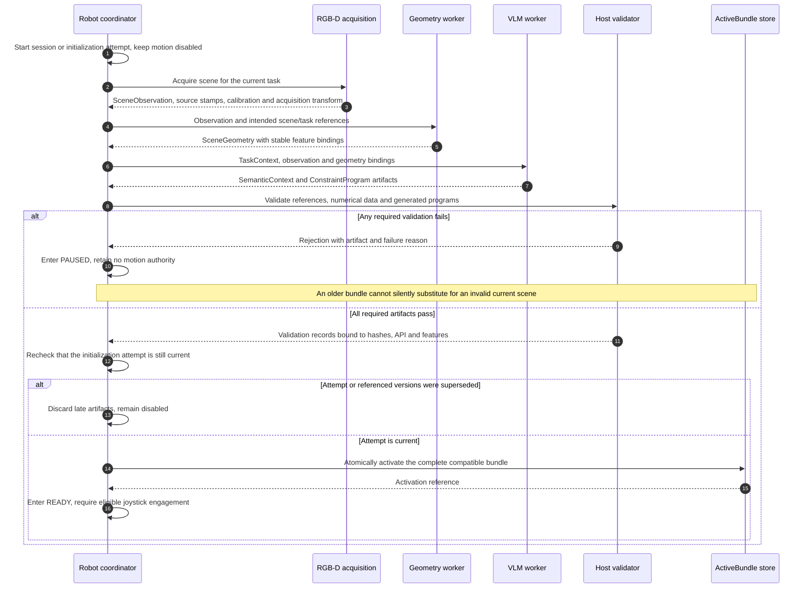
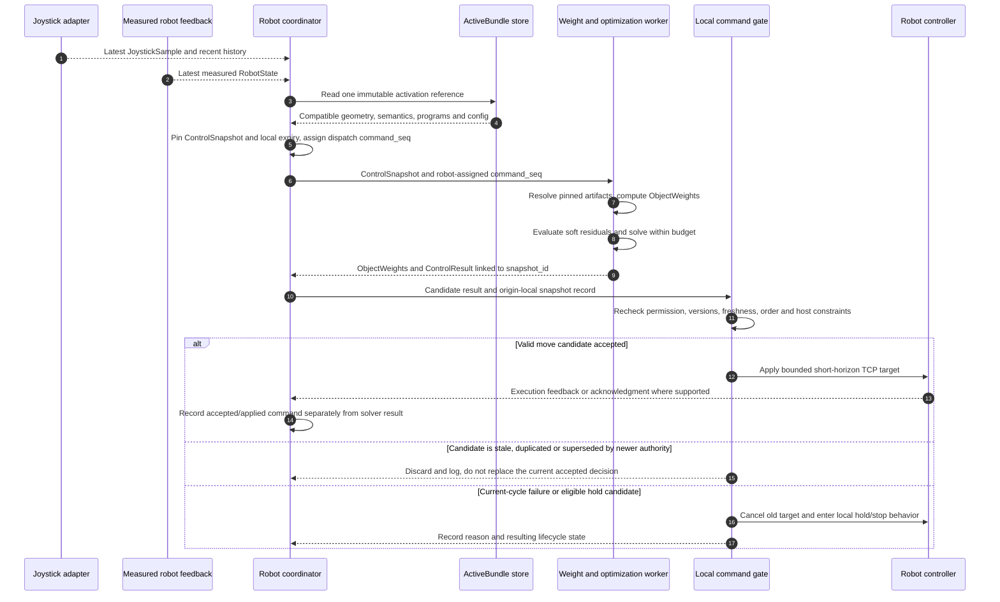
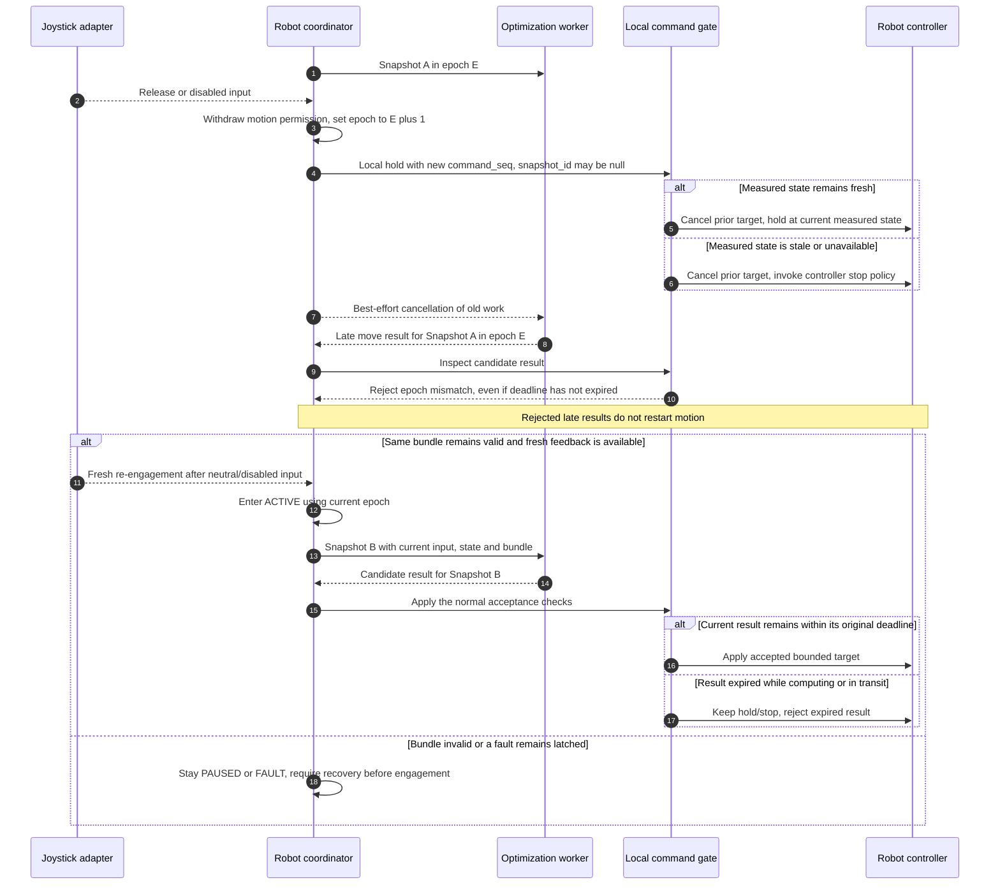
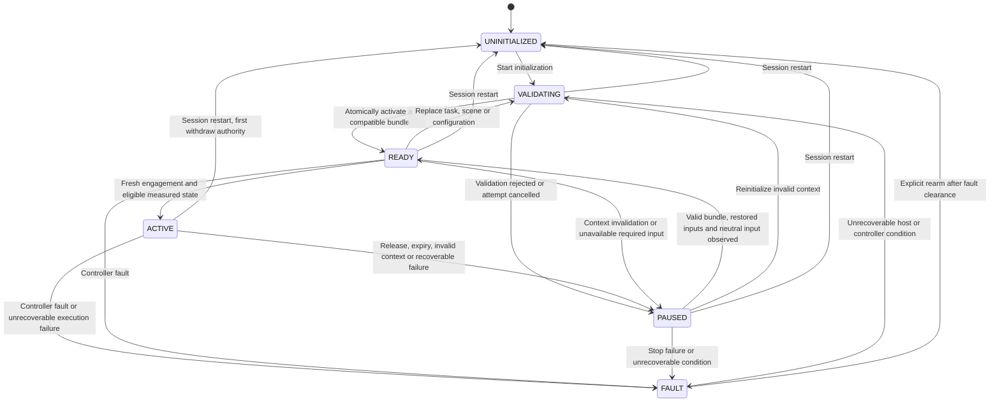

# Runtime Lifecycle and Timing

**Design Draft v0.1 — proposed behavior; not implemented or validated on a robot.**

This page defines when asynchronous perception and semantic results become usable, how a control cycle consumes them, and when the robot accepts a proposed motion. The sequence diagrams describe logical responsibilities. A process may perform more than one role, and their arrows do not prescribe a network transport.

See [System Architecture and Scope](https://github.com/ZenWang00/semantic-shared-control/wiki/System-Architecture-and-Scope) for deployment, [Data Model and Message Contracts](https://github.com/ZenWang00/semantic-shared-control/wiki/Data-Model-and-Message-Contracts) for field definitions, and [Generated Constraint Program Contract](https://github.com/ZenWang00/semantic-shared-control/wiki/Generated-Constraint-Program-Contract) for generated-function validation.

## 1. Activation and ownership

The robot-side coordinator owns the active session, the current `control_epoch`, the lifecycle state, and the final command gate. A worker can propose `ControlResult` values; it cannot authorize its own motion or reactivate a session. The local joystick path can withdraw motion permission without waiting for a worker or the network.

The coordinator maintains one immutable **ActiveBundle**: an internal activation record, not an additional wire message. It contains mutually compatible references to:

- The session and `SessionConfig.config_id`.
- The task ID and task revision.
- The scene, source observation, geometry ID, geometry revision, and feature-set ID.
- The semantic context ID and its task, scene, observation, and feature bindings.
- Every constraint program's immutable artifact ID, source hash, function API version, feature bindings, accepted `ProgramValidationReceipt`, and host-owned `ProgramExecutionBinding` including normalization and weights.

An ActiveBundle is eligible for activation only after every required artifact is available and all references agree. Validation includes the configured coordinate frames, robot model, feature identities, numerical data, and accepted program policy. The coordinator switches the entire activation record atomically. It does not expose partially updated geometry and semantics to a control cycle.

Pending artifacts carry their intended task and scene versions. A result that arrives after its task, scene, configuration, or initialization attempt has been superseded is discarded, even if it is otherwise valid. A superseded initialization attempt never acquires control merely because it finishes last.

`ControlSnapshot` pins the exact versions used by a calculation. The worker resolves those references before evaluation and retains that immutable view for the entire solve. Content behind an identifier must not be overwritten. New background results can become eligible for a later snapshot only through the activation rules.

## 2. Initialization

Initialization starts with an observation acquired alongside its calibration and camera-to-control-frame transform. The transform must describe image acquisition, rather than the later instant when inference completes. In the static-scene first version, activation commits a single scene interpretation for repeated control use.

Successful initialization does not itself move the robot. A fresh joystick engagement and valid measured robot state are required to enter `ACTIVE`. No callback from perception or the VLM may bypass that requirement.

A task change invalidates the old semantic interpretation and pauses control until a compatible interpretation is activated. Scene motion or feature-identity changes require scene reinitialization. A numerically refined geometry revision also replaces an artifact; it is never edited in place. The first version uses the same paused validation-and-activation path for such replacements, rather than silently updating an active solve.

## 3. Clocks, freshness, and deadlines

Time has three distinct uses. They must remain separate in implementation and logs.

| Purpose | Clock and record | Rule |
|---|---|---|
| Capture provenance | Original sensor or robot `TimePoint` with `clock_id` | Preserve it through inference and serialization; `produced_at` does not replace acquisition time. |
| Input freshness | Origin-local sampling/receipt records and documented source timing | Check the age of the measured state and current joystick before snapshot creation and again at command acceptance. A newly received old sample is still old. |
| Control deadline | Robot coordinator's local monotonic clock | Record snapshot creation, dispatch, deadline, result arrival, and acceptance locally. Remote wall clocks cannot extend the deadline. |

The coordinator retains a local registry keyed by `snapshot_id`, containing the session, epoch, bundle/configuration references, `snapshot_seq`, the robot-issued `command_seq` allocated for that dispatch, creation and dispatch times, and absolute monotonic expiry. These are local runtime records. They need not become cross-machine timestamps in the public schema.

The expiry is fixed when the snapshot is formed from the configured maximum command age. Any configured solve budget and transport allowance must fit within that existing freshness budget. Retries, delayed dispatch, remote completion, and result receipt do not restart it. A result whose solve succeeds after the deadline is unusable.

For robot-local joystick and feedback, adapters provide sampling records in a known local clock domain. If a source has a different clock, its adapter needs an explicit validated mapping or a conservative bounded-delay acquisition protocol before claiming source freshness. A receipt timestamp alone measures time since receipt, not time since capture. Subtracting a workstation timestamp from a robot timestamp is prohibited unless their clock relationship and uncertainty have been established. Missing freshness evidence prevents activation or motion; the system does not label it as zero age.

Static geometry and semantics are invalidated by scene/task changes and their declared validity conditions; they do not need to be recomputed at joystick frequency. Their source observation time remains available for traceability. The controller still recalculates the current geometric relationships from the latest robot state on every solve.

`horizon_s` expresses the short future interval associated with a proposed TCP target and must equal the referenced snapshot's `dt_s`. It is not a freshness extension or proof of controller execution. The local execution adapter supplies the configured command timeout/watchdog behavior and cancels prior targets when motion permission is withdrawn. An old target must not remain active indefinitely after upstream updates stop.

No cycle frequency, latency target, timeout, or velocity limit is claimed as a measured capability in this draft. Experiments must configure and report these values together with their observed distributions.

## 4. Normal control cycle

Each cycle uses the newest valid inputs available at its start. It does not wait for all producers to publish together. Joystick history supports intent estimation, while the current joystick sample determines whether motion is presently enabled.

`ObjectWeights` and `ControlResult` must reference the same snapshot. The worker cannot combine current weights with an older state or swap in a later VLM response mid-solve. `previous_applied_command_id` is populated from the robot-side accepted-command history, not from the last successful solver response. Acceptance and physically observed execution remain distinct records.

The local command gate checks the following before accepting `status="move"`:

1. The session, `control_epoch`, pinned bundle/configuration, and referenced snapshot are current and known; the snapshot has not expired.
2. The joystick still permits motion, its input is fresh, and measured robot feedback is fresh. A release always wins over an in-flight result.
3. `command_seq` matches the robot-issued value recorded for this dispatch and is newer than the most recently accepted command sequence in this session. The snapshot's `snapshot_seq` is newer than the most recently accepted move snapshot. Echoed `source_joystick_seq` and `source_robot_state_seq` must match the pinned inputs, not necessarily the most recent live input. A duplicate or out-of-order proposal cannot replace a newer accepted command.
4. The result has the required finite, correctly shaped pose in the configured control/TCP frames and `horizon_s` equals snapshot `dt_s`. Weight and program references agree with the snapshot, `evaluation_valid=true`, and `solver_status="solved"`.
5. Host-owned motion constraints and the current controller state permit the target. This includes configured bounds, robot limits, feasibility, and collision checks available to the execution layer. Solver success alone is insufficient evidence of acceptance.

Normal joystick updates do **not** increment the epoch or require the result's joystick sequence to equal the latest sequence. Such equality would reject virtually every result during continuous input. Ordinary updates are handled through the configured freshness and short-horizon bounds. A release, disable transition, context invalidation, fault, or explicit cancellation withdraws authority and invalidates outstanding work immediately.

The authoritative coordinator allocates `command_seq` values monotonically within a session when it dispatches work or issues a local hold. Workers echo the dispatch-assigned value; they do not assign sequence numbers in completion order. The dispatch envelope and local registry associate that value with `snapshot_id`; `ControlSnapshot` itself carries `snapshot_seq` for cycle order. A later number does not excuse an older snapshot or an expired result, and a worker cannot substitute a different number. Multiple workers must not independently create competing command streams. The local gate records both the order and the age of accepted snapshots.

A positive soft residual means a desired relationship is still unsatisfied. It does not by itself make a small intermediate movement invalid. These outcomes are recorded separately: `evaluation_valid`, `solver_status`, individual relation residuals, `constraints_satisfied`, local `CommandAcceptanceRecord.command_accepted`, and controller execution. In particular, `constraints_satisfied=false` is allowed during an otherwise valid approach; this field uses host evaluation tolerances and is not a hard-constraint certificate.

`status="hold"` is also a candidate result. A worker-originated hold retains its causal snapshot and dispatch-assigned sequence and cannot override newer authority or a newer accepted decision. An immediate robot-local hold may use `snapshot_id=null` and `weights_id=null`; the robot assigns a new `command_seq`, records the current epoch and diagnostic reason, and invokes local hold/stop without waiting for a snapshot or worker. The gate distinguishes this trusted local stop path from received worker proposals. No hold contains `next_tcp_pose` or `horizon_s`. Rejecting an old-session, old-epoch, duplicate, or otherwise superseded result does not cancel a newer accepted decision. Current-authority failure and liveness watchdogs independently decide when to withdraw motion permission; discarded old messages do not keep control alive.

## 5. Release, late results, and re-engagement

A dead-zone release or `enabled=false` is processed on the local input path. It does not wait for a control cycle, an RPC response, or optimization completion. The coordinator withdraws motion permission, increments `control_epoch`, and cancels the previous target. Worker cancellation is best effort; epoch validation remains necessary even if cancellation is requested.

A hold target is derived from fresh **measured** state, not a remembered commanded pose. If valid feedback is unavailable, the execution adapter invokes the robot/controller stop mechanism; it does not invent a pose from stale feedback. This mechanism must be specified and verified for the actual controller during implementation. A hold request is not a claim that physical motion has already stopped.

An ordinary release leaves a still-valid ActiveBundle available. After the release, a new eligible engagement can resume control without rerunning perception or the VLM. Geometry/semantic invalidation uses a different recovery path: first replace and validate the affected context, then require a fresh engagement. Automatic background completion never resumes motion while a previous nonzero joystick input is still held.

## 6. Lifecycle and recovery

The lifecycle is owned by the robot coordinator. `READY` means the context is valid but motion is disabled. `ACTIVE` grants only conditional, short-lived permission: each candidate still passes the local gate. `PAUSED` records a recoverable withdrawal of permission. `FAULT` is latched and requires explicit operator rearm after its cause is addressed.

The transition table clarifies required actions. Every transition that withdraws existing motion authority increments `control_epoch`, cancels outstanding work, and requests local hold/stop before any possible re-entry to `ACTIVE`.

| Event | Immediate behavior | Recovery |
|---|---|---|
| Ordinary release or disable | Cancel old target; reject previous-epoch results; enter `PAUSED`. | With the same valid bundle and fresh feedback, observe neutral/disabled input and return to `READY`; new engagement permits `ACTIVE`. |
| Stale joystick/state, missed result deadline, invalid numerical evaluation, no valid candidate, or invalid solve | Withdraw motion authority and enter `PAUSED`; stop through the controller when feedback cannot support a hold pose. | Restore valid input or computation, retain the bundle only if it remains valid, then require neutral input and a new engagement. |
| Task, scene, semantic, feature, or configuration invalidation | Withdraw motion authority; mark the incompatible bundle ineligible. | Run validation/reinitialization, activate a compatible bundle, and require a new engagement. |
| Controller fault, failed stop request, or unrecoverable execution condition | Latch `FAULT`; withdraw authority and use the controller's fault/stop procedure. | Explicit operator rearm after fault clearance returns to `UNINITIALIZED`; reinitialize before motion. |
| Session restart | Withdraw authority before resetting runtime state; discard pending work, active acceptance records, and old command authority. | Allocate a new `session_id`, initialize fresh session counters, and complete initialization and engagement again. |

A result from an unknown or prior session is discarded regardless of its sequence number or timestamp. Session counters can restart only with a new session ID. A clock-domain epoch reset also starts a new session so that old freshness records cannot be reused. A disconnect does not allow a remote worker to choose a replacement session or restore the prior epoch. The robot-side coordinator remains the authority.

## 7. Runtime evidence and acceptance scenarios

For each cycle, record the snapshot ID, session/epoch, pinned artifact versions, local creation/dispatch/arrival/acceptance times, input ages, solve duration, residuals, worker status, local decision/reason, and any controller acknowledgment. Keep an acceptance record separate from the proposed `ControlResult`; record actual execution only to the extent supported by measured feedback or explicit controller acknowledgment.

The runtime design is accepted when replay and later integration tests demonstrate:

- Out-of-order perception responses cannot activate superseded tasks or scenes, and no snapshot sees a partially replaced bundle.
- Artificial workstation clock offsets do not change command expiry or turn an old sensor sample into a fresh one.
- A normally delayed result can be accepted within configured bounds while joystick sequence numbers continue increasing.
- Release rejects a prior-epoch result even when that result is otherwise fresh; re-engagement accepts only work created with current authority.
- An older snapshot cannot displace a newer accepted one; a worker that substitutes a larger command sequence than its dispatch assignment is rejected.
- A successful solve with a positive soft relation residual can produce an accepted intermediate motion, while a violated host constraint prevents acceptance.
- A stale measured state invokes controller stop behavior rather than a hold at an old target; lost upstream updates cannot leave an old target active indefinitely.
- Recoverable failures, context invalidation, and latched faults follow their distinct recovery requirements; no asynchronous callback resumes motion by itself.

These are requirements for future implementation and validation, not completed test results. The documentation-only checks and legacy integration boundaries are described in [Validation and Legacy Integration](https://github.com/ZenWang00/semantic-shared-control/wiki/Validation-and-Legacy-Integration).

[Back to Home](https://github.com/ZenWang00/semantic-shared-control/wiki/Home)
