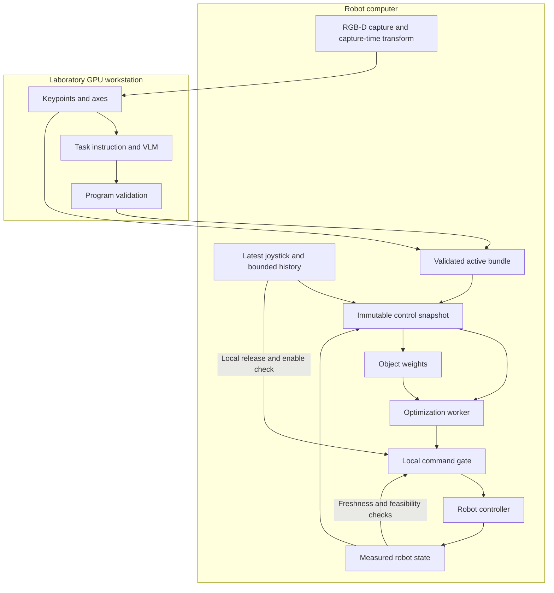

# System Architecture and Scope

**Design Draft v0.1 — proposed architecture, not deployed behavior.**

The system combines three information sources with measured robot feedback:

1. **Joystick input** expresses the user's current XY motion request and provides recent evidence for target preference.
2. **VLM semantics** supplies object task-relevance scores and geometric relation programs.
3. **Scene geometry** grounds objects, keypoints, and axes in a common coordinate frame.
4. **Measured robot state** supplies the current TCP pose and joints required to evaluate the next motion step.

The proposed output is one short-horizon TCP pose. A continuous user command participates in every optimization cycle. There is no discrete transition from target selection to an independently completed autonomous grasp.

## Deployment and responsibilities

ROS2 is a communication and component framework, not a physical location. A ROS2 node can also run on the laboratory GPU workstation. The initial recommendation separates expensive asynchronous computation from the robot-facing control path.

Source ownership is specified in [Repository Ownership and Cross-Repository Workflow](https://github.com/ZenWang00/semantic-shared-control/wiki/Repository-Ownership-and-Cross-Repository-Workflow). The server repository maintains shared contracts and algorithm libraries, including fusion and optimization. The ROS2 repository consumes a versioned library and owns devices, active-context coordination, snapshots, final command acceptance, and lifecycle/stop behavior. The locations below remain unchanged: server-owned algorithm code can execute on the robot computer without a network service or reverse dependency on ROS2.

| Component | Initial location | Responsibility |
| --- | --- | --- |
| Capture adapter | Robot computer | Synchronize RGB and aligned depth, attach source timestamps/calibration, retain the camera transform at capture. |
| Perception and semantic service | LAN GPU workstation | Extract features; call a VLM; return geometry, relevance, and generated programs with provenance. A cloud VLM API may be used by this service. |
| Program validation and bundle activation | Host-controlled preparation stage | Validate program/data compatibility before making a bundle available to the control path. Final activation authority remains robot-side. |
| Joystick and measured-state adapters | Robot computer | Normalize device input; expose measured state with explicit frames, units, and original timestamps. |
| Snapshot assembly and weight update | Robot computer | Select compatible inputs, freeze one snapshot, compute object support and assistance strength. |
| Optimization worker | Initially robot computer, separate from command gate | Evaluate candidate TCP poses and generate a bounded-horizon result. Its implementation and solver are not selected here. |
| Command gate and controller adapter | Robot computer | Enforce epoch, freshness, ordering, input enable, and host constraints; implement local stop/hold behavior. |

Moving the optimizer to the LAN workstation remains possible because the snapshot/result contract is transport-independent. Such a move requires measured end-to-end deadlines and failure handling; GPU availability alone is not sufficient evidence that remote optimization meets the control budget.

Arrows show proposed dependencies, not a blocking chain executed for every joystick sample. VLM calls and geometry extraction are not repeated at every control tick. A failed or incomplete preparation stage cannot partially replace the active bundle.

## Two meanings of geometry processing

**Scene extraction** estimates fixed object geometry from the initial observation. **Candidate evaluation** recomputes distances and alignments for each candidate TCP pose during optimization. The former can be cached in a static scene; the latter changes as the robot moves.

An object axis does not move with a candidate TCP pose in this version. Modeling a grasped object would require attachment state and candidate-dependent geometry, and is deliberately outside v0.1.

## User influence and optimization boundary

For normalized input `u_xy` with Euclidean norm at most one, the requested planar velocity is:

$$v_{user,xy}=v_{max}u_{xy}.$$

The optimizer is intended to combine joystick consistency, object-weighted geometric assistance, and smoothness, subject to host-defined motion and robot constraints. This document fixes the data needed by those terms; it does not choose a solver, weight-update algorithm, or validated gain schedule.

The requested velocity is not a promise that the robot always achieves it. Reachability, collision checks, and motion limits may reduce or prevent motion. A zero or disabled joystick request is handled by the local command gate and cannot be overridden by semantic assistance or a smoothness objective.

Generated residuals are soft assistance terms. Positive residuals are expected during approach and do not automatically require stopping. Invalid inputs, invalid computation, stale results, and rejected host constraints are separate conditions.

The shared optimizer accepts host constraints through a transport-independent interface; robot-specific implementations and model configuration belong to the ROS2 repository. The robot-side gate independently rechecks the proposed target against current authority, timing, controller state and host constraints. Injecting constraints into an algorithm neither authorizes its result nor creates a server-to-ROS2 source dependency.

## Transport and reuse

The data model is independent of HTTP and ROS2 wire definitions. A future transport adapter may use HTTP for scene jobs and ROS2 topics for current state and commands. This draft does not declare endpoints or ROS message packages to exist.

The inherited VLA service provides useful RGB-D handling, provider calls, segmentation, reporting, and environment separation. Its older cycle produces discrete grasp candidates and uses a polling bridge; it does not implement the new continuous shared-control contract. Contact-GraspNet is not a required dependency of the keypoint-and-axis formulation merely because its code is present in the baseline.

For concrete migration differences and pinned source references, see [Validation and Legacy Integration](https://github.com/ZenWang00/semantic-shared-control/wiki/Validation-and-Legacy-Integration). For timing and cancellation, see [Runtime Lifecycle and Timing](https://github.com/ZenWang00/semantic-shared-control/wiki/Runtime-Lifecycle-and-Timing).
